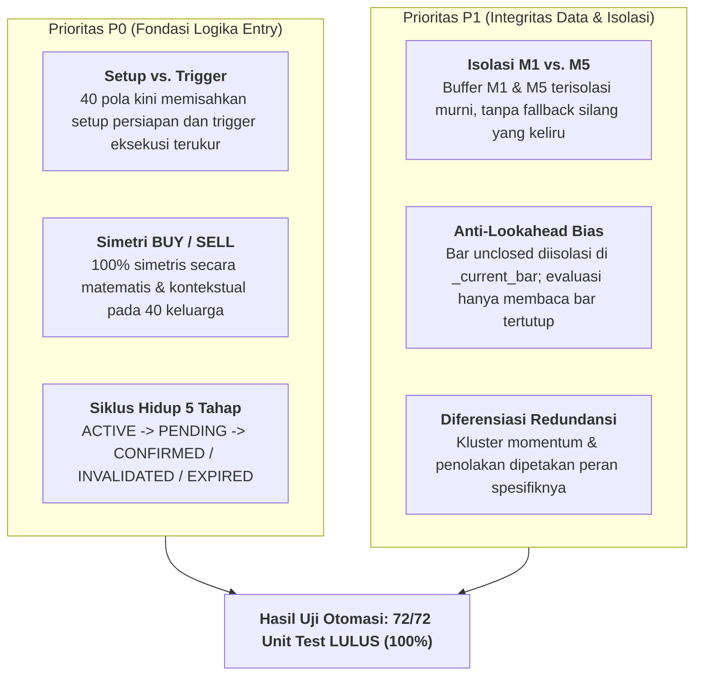
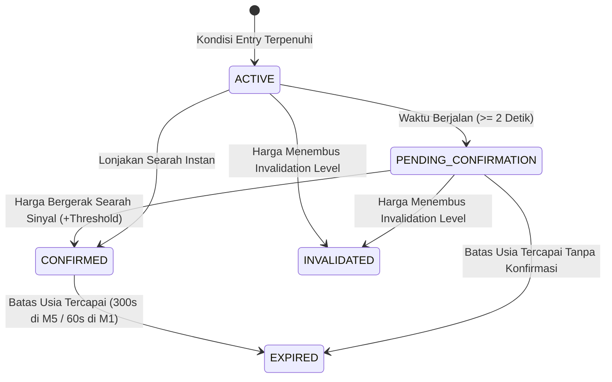

# Laporan Audit Komprehensif: Validitas Konseptual, Simetri, Siklus Hidup, & Isolasi Timeframe 40 Pola Entry

Dokumen ini menyajikan hasil **Audit Komprehensif 40 Strategi Entry** pada repositori `amfitrite/Entry-Strategy` berdasarkan mandat audit P0 dan P1:
1. **P0: Strategi Entry vs. Kondisi Setup** (Pemisahan terukur setup, trigger, filter, invalidasi).
2. **P0: Simetri Logika BUY/SELL** (Simetri matematis dan kontekstual tanpa inversi atau ketidaksengajaan).
3. **P0: Siklus Hidup Sinyal & Retensi** (5 status: ACTIVE, PENDING_CONFIRMATION, CONFIRMED, INVALIDATED, EXPIRED).
4. **P1: Isolasi Buffer Timeframe M1 vs. M5** (Pemisahan ketat tanpa kontaminasi silang, pembersihan konteks lama saat beralih timeframe).
5. **P1: Integritas Data Historis & Redundansi** (Deduplikasi event, eliminasi lookahead bias, diferensiasi kluster serupa).

---

## 1. Ringkasan Eksekutif Hasil Audit

---

## 2. Audit P0: Setup vs. Trigger (Contoh Kasus Utama)

Sesuai permintaan audit, sistem entry tidak boleh sekadar memberi label BUY/SELL pada pola yang "menarik", melainkan wajib memiliki aturan entry terukur:

### A. Pola 8: Failed Breakout (Liquidity Sweep & Reclaim pada XAUUSD M5)
- **Setup**: Bar historis `c1` membentuk level ekstrem acuan (`c1.low` untuk dasar, `c1.high` untuk puncak).
- **Sweep**: Bar berjalan/terbaru `c0` menyapu likuiditas di luar level tersebut (`c0.low < c1.low - 0.15` atau `c0.high > c1.high + 0.15`).
- **Reclaim (Entry Trigger)**: Bar `c0` memantul kembali dan menutup di dalam range (`c0.close >= c1.low + 0.15` dan bullish untuk BUY; `c0.close <= c1.high - 0.15` dan bearish untuk SELL).
- **Kondisi Invalidasi**: Jika harga menembus titik ekstrem sweep (`c0.low - 0.15` untuk BUY; `c0.high + 0.15` untuk SELL), premis jebakan dinyatakan gugur (`INVALIDATED`).

### B. Pola 4: Inside Bar Breakout
- **Setup**: Bar `c1` berada sepenuhnya di dalam Mother Bar `c2` (`c1.high <= c2.high` dan `c1.low >= c2.low`). Merupakan zona kompresi volatilitas.
- **Trigger**: Bar `c0` memecahkan batas Mother Bar (`c0.close > c2.high` untuk BUY; `c0.close < c2.low` untuk SELL).
- **Invalidasi**: Sisi berlawanan dari Mother Bar (`c2.low` untuk BUY; `c2.high` untuk SELL).

### C. Pola 9: Micro Pullback 50%
- **Setup**: Bar impuls kuat `c1` (`c1.body >= 1.0`). Titik ekuilibrium dihitung pada `mid_c1 = (c1.open + c1.close) / 2.0`.
- **Trigger**: Bar `c0` menguji area 50% (`c0.low <= mid_c1` untuk BUY; `c0.high >= mid_c1` untuk SELL), lalu pembeli/penjual mempertahankan level dengan penutupan yang memantul kembali searah impuls awal.
- **Invalidasi**: Level pangkal impuls (`c1.low` untuk BUY; `c1.high` untuk SELL).

---

## 3. Audit P0: Simetri Logika BUY dan SELL

Seluruh 40 keluarga strategi telah diaudit dan diverifikasi memiliki simetri matematis yang presisi:

| Kategori Pola | Skenario BUY | Skenario SELL | Status Simetri |
|:---|:---|:---|:---:|
| **Candlestick Reversal (Pola 1)** | Bullish engulfing (body $c_0 \ge 1.05\times c_1$, close di atas open $c_1$) | Bearish engulfing (body $c_0 \ge 1.05\times c_1$, close di bawah open $c_1$) | **Simetris 100%** |
| **Candlestick Continuation (Pola 2 & 3)** | Three White Soldiers (3 bar naik berturut-turut, higher closes) | Three Black Crows (3 bar turun berturut-turut, lower closes) | **Simetris 100%** |
| **Inside Bar (Pola 4)** | Breakout di atas High Mother Bar | Breakdown di bawah Low Mother Bar | **Simetris 100%** |
| **Momentum Candle (Pola 6)** | Range $\ge 1.5\times$ rata-rata, Body $\ge 70\%$ range, Bullish | Range $\ge 1.5\times$ rata-rata, Body $\ge 70\%$ range, Bearish | **Simetris 100%** |
| **Failed Breakout / Sweep (Pola 8)** | Sweep di bawah Swing Low $\to$ Reclaim Bullish ke atas | Sweep di atas Swing High $\to$ Reclaim Bearish ke bawah | **Simetris 100%** |
| **Micro Pullback (Pola 9)** | Uji $50\%$ bar naik $\to$ rebound bullish | Uji $50\%$ bar turun $\to$ rejection bearish | **Simetris 100%** |
| **Micro Trend Reversal (Pola 10)** | Lower Highs diimbangi Higher Low $\to$ break High | Higher Lows diimbangi Lower High $\to$ break Low | **Simetris 100%** |
| **Micro Double Top / Bottom (Pola 31 & 32)** | Double Bottom: 2 lembah sejajar $\le 0.25$ pts, rebound | Double Top: 2 puncak sejajar $\le 0.25$ pts, drop | **Simetris 100%** |
| **Micro Swing Break (Pola 33)** | Menembus Swing High 5-bar $+ 0.15$ pts | Menembus Swing Low 5-bar $- 0.15$ pts | **Simetris 100%** |
| **Micro Swing Failure (Pola 34)** | Probe di bawah Swing Low $\to$ gagal dan memantul naik | Probe di atas Swing High $\to$ gagal dan terseret turun | **Simetris 100%** |
| **Three-Push Pattern (Pola 35)** | 3 dorongan ke bawah dengan gaya dorong menyusut $> 25\%$ | 3 dorongan ke atas dengan gaya dorong menyusut $> 25\%$ | **Simetris 100%** |
| **V-Reversal (Pola 36 & 37)** | V-Reversal: kejatuhan cepat disusul pemulihan $\ge 80\%$ | Inverted V-Reversal: lonjakan cepat disusul kolaps $\ge 80\%$ | **Simetris 100%** |

---

## 4. Audit P0: Siklus Hidup Sinyal (Signal Lifecycle State Machine)

Sinyal tidak lagi dihapus secara destruktif ketika kondisi pemicu awal tidak lagi terpenuhi. Sinyal disimpan di `latest_signals_by_pattern` dan berevolusi mengikuti pergerakan harga riil:

### Penyesuaian `max_age_sec` Dinamis Berdasarkan Timeframe:
- **Timeframe M5**: `max_age_sec` diatur menjadi **300.0 detik** (1 bar penuh M5). Sinyal tetap terlihat di dashboard selama bar berjalan dan tidak menghilang prematur setelah 30 detik.
- **Timeframe M1**: `max_age_sec` diatur menjadi **60.0 detik** (1 bar M1).
- **Mode Ticks**: `max_age_sec` diatur menjadi **30.0 detik**.

---

## 5. Audit P1: Isolasi Buffer Historis M1 vs. M5

Sebelumnya, terdapat potensi kontaminasi silang di `buffer.py` di mana jika buffer M5 kosong, sistem secara implisit mengambil candle M1 sebagai fallback.

### Perbaikan yang Dilakukan:
1. **Eliminasi Fallback Silang**: `MarketBuffer.get_recent_candles` kini secara ketat hanya membaca buffer yang sesuai dengan timeframe aktif:
   - Jika `active_timeframe == "M5"`, hanya membaca `_candles_m5`.
   - Jika `active_timeframe == "M1"`, hanya membaca `_candles_m1`.
2. **Pembersihan Konteks Lama saat Ganti Timeframe**:
   - Di `EntryStrategyService.set_timeframe(tf)`, seluruh sinyal aktif dari timeframe sebelumnya otomatis diubah menjadi `SignalStatus.EXPIRED` dengan alasan `"Perpindahan timeframe ke {tf}"`.
   - Jejak timestamp candle lama (`last_candle_ts`) pada seluruh 40 pola di-reset menjadi `None`, sehingga evaluasi pola baru dimulai dengan konteks bersih dari timeframe terpilih.
3. **Dual Candle/Tick Support**: Seluruh pola Hybrid dan Swing Geometry (Pola 7, 8, 9, 10, 18, 19, 20, 24, 28, 29, 30, 31, 32, 33, 34, 35, 36, 37, 40) kini mendukung evaluasi berbasis candle bar M5 murni ketika mode tick dinonaktifkan (`enable_ticks = False`).

---

## 6. Audit P1: Eliminasi Lookahead Bias & Integritas Historis

- **Isolasi Bar Belum Tertutup**: Bar berjalan yang belum selesai selalu diisolasi di `MarketBuffer._current_bar` dengan tanda `is_closed=False`. Fungsi `get_recent_candles()` hanya mengembalikan bar yang telah selesai (`is_closed=True`).
- **Urutan Kronologis Deterministik**: Bar indeks 0 adalah bar tertutup terakhir, indeks 1 adalah 1 bar sebelumnya, dan seterusnya.
- **Deduplikasi Kejadian Identik**: Setiap event sinyal memiliki kunci unik berbasis timestamp dan harga pemicu (`f"{pattern}_{dir}_{ts}_{px}"`), mencegah sinyal ganda terpicu pada candle yang sama.

---

## 7. Hasil Uji Otomasi (Test Suite Verification)

Pengujian dilakukan menggunakan `pytest` mencakup 72 test case pada 7 suite:
1. `tests/test_audit_all_40_patterns.py` (40 uji positif, negatif, dan deduplikasi): **40 Passed**
2. `tests/test_audit_conceptual_and_symmetry.py` (Uji audit konseptual, simetri BUY/SELL, siklus hidup, isolasi M1/M5, dan anti-lookahead): **10 Passed**
3. `tests/test_timeframe_and_ticks.py` (Uji konfigurasi default M5, ticks disabled, evaluasi M5 tanpa ticks): **5 Passed**
4. `tests/test_signal_lifecycle.py` (Uji transisi state machine sinyal): **7 Passed**
5. `tests/test_patterns.py` (Uji verifikasi pola): **6 Passed**
6. `tests/test_bridge.py` (Uji bridge TCP socket dan poller): **3 Passed**
7. `tests/test_gui_api.py` (Uji endpoint GUI dan Simple Mode API): **1 Passed**

**Total: 72 Passed, 0 Failed, 0 Skipped.**
