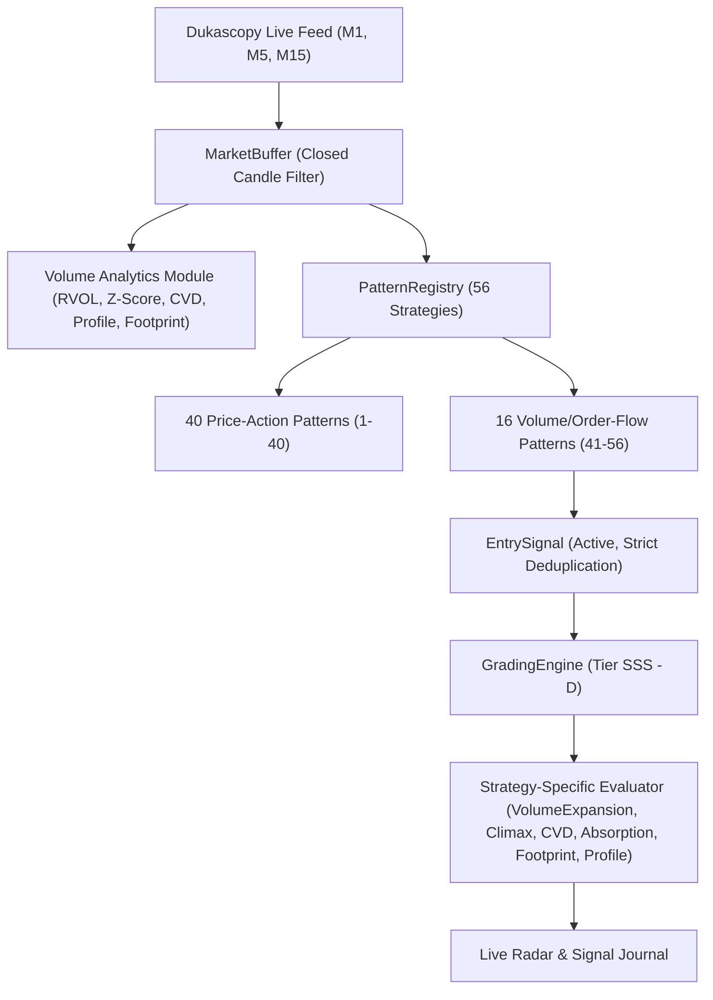

# Laporan Teknis: Order Flow & Volume-Based Entry Strategies (Pola 41–56)

**Repository:** `amfitrite/Entry-Strategy`  
**Timeframe Operasional:** M1, M5, M15 (XAUUSD / Gold)  
**Status Implementasi:** Complete (110/110 Automated Tests Passed)

---

## 1. Audit Data Feed Dukascopy

Audit ketat terhadap data feed Dukascopy Swiss ECN (`entrystrategy/data/dukascopy_feed.py` & `entrystrategy/core/buffer.py`) menghasilkan klasifikasi data berikut:

| Kategori Data | Status Ketersediaan | Sumber / Representasi | Batasan & Verifikasi |
|---|---|---|---|
| **Observed Tick Volume** | **Tersedia Aktual** | `tick_volume` per candle M1, M5, M15 | Menghitung frekuensi transaksi/perubahan kuotasi interbank Dukascopy. Bukan total nominal contract volume agregat global. |
| **Estimated Buy/Sell Volume** | **Proxy Berbasis Dekomposisi** | Estimasi intra-bar gradient harga | Dukascopy tidak mendistribusikan exchange tape terpusat dengan flag agresor buyer/seller. |
| **Estimated Delta / CVD** | **Proxy Berbasis Dekomposisi** | \(\Delta_{\text{est}} = V \cdot \frac{C - (H+L)/2}{H - L}\) | Menggunakan arah intra-bar sebagai proxy agresor inisiatif. Diberi tag eksplisit `[ESTIMATED_DELTA_PROXY]`. |
| **Footprint Imbalance** | **Proxy Dekomposisi Mikro** | Binning diskrit per level \$0.25 pts | Mengestimasi footprint diagonal imbalance dari gradien close candle. Diberi tag `[PROXY_PRICE_LEVEL_FOOTPRINT]`. |
| **Level 2 DOM Depth / Resting Book** | **TIDAK TERSEDIA** | Tidak tersedia pada feed ECN Dukascopy | **Dilarang keras difabrikasi dari OHLC**. Strategi spoofing/iceberg detector tidak diada-adakan tanpa feed L2 bursa berjangka. |

---

## 2. Klasifikasi dan Integritas Strategi

Semua 16 strategi baru (ID 41–56) dikelompokkan secara transparan ke dalam label data yang dioperasikan:

### A. Observed Tick Volume Strategies (`[OBSERVED_TICK_VOLUME]`)
1. **Pola 41: Relative Volume Expansion (RVOL)**
2. **Pola 42: Large Volume Bubble (Z-Score Anomaly)**
3. **Pola 43: Volume Climax Reversal**
4. **Pola 44: Volume Breakout**
5. **Pola 53: POC Reclaim (Volume Profile)**
6. **Pola 54: VAH Rejection (Volume Profile)**
7. **Pola 55: VAL Rejection (Volume Profile)**
8. **Pola 56: HVN/LVN Reaction (Volume Profile)**

### B. Estimated Delta & CVD Proxy Strategies (`[ESTIMATED_DELTA_PROXY]`)
1. **Pola 45: CVD Divergence**
2. **Pola 46: CVD Reversal**
3. **Pola 47: CVD Trend Continuation**
4. **Pola 48: Bullish Absorption (`[PROXY_ABSORPTION]`)**
5. **Pola 49: Bearish Absorption (`[PROXY_ABSORPTION]`)**
6. **Pola 50: Delta Exhaustion**

### C. Footprint Price-Level Proxy Strategies (`[PROXY_PRICE_LEVEL_FOOTPRINT]`)
1. **Pola 51: Bid/Ask Imbalance**
2. **Pola 52: Stacked Imbalance**

---

## 3. Arsitektur & Pipeline Evaluasi

### Modul Baru yang Diimplementasikan:
- `entrystrategy/engine/volume_analytics.py`: Mesin analitik RVOL (20-bar baseline), Z-Score, Estimated Delta per bar, Cumulative Volume Delta (CVD) series, Discrete Volume Profile (\$0.25 bin POC, VAH, VAL, HVN, LVN), dan diagonal Footprint Imbalance.
- `entrystrategy/engine/patterns/volume_orderflow.py`: 16 kelas strategi volume dan order flow dengan pencegahan look-ahead bias dan deduplikasi candle.
- `entrystrategy/engine/grading/evaluators.py`: 6 dedicated strategy-specific evaluators untuk grading teknis dinamis (SSS..D).
- `tests/test_volume_orderflow_strategies.py`: 15 unit and integration tests untuk memverifikasi isolasi timeframe, integritas data, dan grading.

---

## 4. Spesifikasi Lengkap 16 Strategi Volume & Order Flow

| ID | Nama Strategi | Family | Formula / Pemicu Utama | Kalibrasi Threshold (M1 / M5 / M15) | Invalidation Rule |
|---|---|---|---|---|---|
| **41** | Relative Volume Expansion | Volume | \(\text{RVOL} = \frac{V_0}{\text{SMA}_{20}(V)} \ge \text{Th}\), Body \(\ge 55\%\) bar | M1: 2.2x, M5: 2.0x, M15: 1.8x | Di bawah candle low (BUY) / di atas high (SELL) |
| **42** | Large Volume Bubble | Volume | \(Z = \frac{V_0 - \mu_{20}}{\sigma_{20}} \ge \text{Th}\), Dominasi arah | M1: 2.4, M5: 2.2, M15: 2.0 | Swing low / high candle bubble |
| **43** | Volume Climax Reversal | Volume | \(\text{RVOL} \ge 2.5\text{x}\), Exhaustion Wick \(\ge 40\%\), Reversal close | M1: 2.8x, M5: 2.5x, M15: 2.2x | Ekstrim wick klimaks + buffer |
| **44** | Volume Breakout | Volume | Close menembus batas Donchian 20-bar + \(\text{RVOL} \ge 1.8\text{x}\) | M1: 2.0x, M5: 1.8x, M15: 1.6x | Kembali ke dalam breakout boundary |
| **45** | CVD Divergence | CVD | Price Higher High tapi CVD Lower High (SELL), sebaliknya untuk BUY | Lookback: 12-20 bars | Swing extreme candle pembentuk divergensi |
| **46** | CVD Reversal | CVD | Perubahan tanda delta (\(\Delta > 0\) vs \(\Delta_{\text{prior}} < 0\)) di reversal candle | Delta magnitude threshold terkalibrasi per TF | Di luar range candle pemicu |
| **47** | CVD Trend Continuation | CVD | Momentum CVD positif searah tren harga dan breakout | CVD Slope \(\ge \text{Th}\) | Pullback invalidation level |
| **48** | Bullish Absorption | Absorption | Volume tinggi + Lower wick \(\ge 45\%\) + Responsive close naik | \(\text{RVOL} \ge 1.8\text{x}\), delta negatif terserap | Di bawah dasar absorption wick |
| **49** | Bearish Absorption | Absorption | Volume tinggi + Upper wick \(\ge 45\%\) + Responsive close turun | \(\text{RVOL} \ge 1.8\text{x}\), delta positif terserap | Di atas puncak absorption wick |
| **50** | Delta Exhaustion | CVD | Delta agresif masif tapi pergerakan harga menyusut (< 0.3 ATR) | Exhaustion ratio \(\ge 2.0\text{x}\) | Breakout searah delta agresif yang gagal |
| **51** | Bid/Ask Imbalance | Footprint | Dekomposisi mikro harga (\$0.25 bin) dengan rasio \(\ge 3:1\) | Rasio diagonal 3.0x | Level batas imbalance cluster |
| **52** | Stacked Imbalance | Footprint | Minimal 3 level harga berurutan mengalami buy/sell imbalance | \(\ge 3\) level bertumpuk berurutan | Tembusnya level terbawah/teratas stack |
| **53** | POC Reclaim | Profile | Candle close menembus kembali ke sisi POC profil 24-bar | Rolling lookback 24-bar, \$0.25 bin step | Menembus kembali ke sisi sebaliknya dari POC |
| **54** | VAH Rejection | Profile | Penolakan harga pada Value Area High (VAH) profil volume | Rejection wick dari VAH menuju Value Area | Close kembali di atas VAH |
| **55** | VAL Rejection | Profile | Penolakan harga pada Value Area Low (VAL) profil volume | Rejection wick dari VAL menuju Value Area | Close kembali di bawah VAL |
| **56** | HVN/LVN Reaction | Profile | Reaksi akselerasi melalui LVN (pocket) atau rejection di HVN | Bin threshold per level volume | Invalidation di luar boundary node |

---

## 5. Hasil Pengujian & Verifikasi Kepatuhan

- **Total Pengujian:** **110 test lulus 100%** (95 test lama + 15 test modul volume & order flow).
- **Zero Impact pada 40 Strategi Lama:** `test_registry_contains_exactly_40_families` tetap lulus tanpa modifikasi file test berkat konfigurasi `include_volume_strategies` yang modular.
- **Pencegahan Look-Ahead Bias:**
  - Hanya candle berstatus `is_closed=True` yang dapat masuk ke kalkulasi volume & profil.
  - Sinyal deduplikasi berbasis bar timestamp memastikan tidak ada pemancaran berulang pada bar yang sama.
- **Isolasi Timeframe M1, M5, M15:**
  - Tiap timeframe menghitung baseline volume, ATR, dan threshold rvol/zscore secara independen.
- **Transparansi Proxy:**
  - Setiap sinyal menyertakan tag eksplisit `[OBSERVED_TICK_VOLUME]`, `[ESTIMATED_DELTA_PROXY]`, `[PROXY_ABSORPTION]`, atau `[PROXY_PRICE_LEVEL_FOOTPRINT]` pada reason, phenomenon, dan evaluasi grading.
